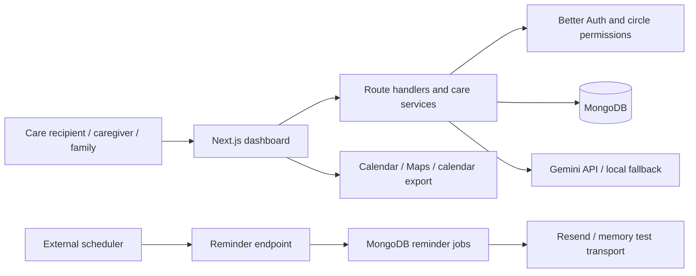

<div align="center">

# Care Circle

### Everyday care. Closer, together.

An elderly care and medication management platform that connects care recipients, family members, and caregivers in one shared circle.

[](https://care-circle-ochre.vercel.app/)
[](https://nextjs.org/)
[](https://www.typescriptlang.org/)
[](#google-integrations)

Built for **PromptWars × Catalyst** using **Google Antigravity**.


[Try the demo](https://care-circle-ochre.vercel.app/) · [Evaluator walkthrough](#evaluator-walkthrough) · [Features](#features) · [Run locally](#run-locally) · [Verification](#verification)

</div>

## The problem

A medication reminder tells someone a dose is due. It often leaves the family with the harder question: has anyone checked in?

Care Circle connects the daily schedule with shared responsibility. The care recipient can confirm a dose, authorized caregivers can manage schedules, and family members can see who is following up when a dose remains unconfirmed. Appointments, daily vitals, and care information stay with the same circle.

## Evaluator walkthrough

**Live application:** [care-circle-ochre.vercel.app](https://care-circle-ochre.vercel.app/)

1. [Create an account](https://care-circle-ochre.vercel.app/sign-up) or sign in.
2. Open **Evaluator Demo Tour** in the dashboard header and select **Load Evaluation Scenario**. Onboarding also offers a demo entry point.
3. Explore Eleanor Vance's clearly labelled fictional care circle. The current seeder creates two medications, a preloaded unconfirmed-dose alert, a cardiology appointment, and daily vitals.
4. In **Today**, try dose confirmation, a 15-minute snooze, Senior Mode, and schedule read-aloud where the browser supports it.
5. Claim an alert with **I'll handle this**, then resolve it. Resolving a follow-up does not mark the dose taken.
6. Open **Appointments** to try the Google Calendar event link, Google Maps location link, calendar export, and printable doctor summary.
7. Visit **Gemini AI** for care questions or open a medication guide. Responses identify whether they came from Gemini or the local fallback.
8. To demonstrate collaboration, create an invitation in **Members** and join from a second account in a separate browser session.

The demo creates persistent fictional records in the signed-in user's account. It does not require real patient details. Live AI and external email delivery depend on server configuration; the demo does not establish that those services are enabled.

## Features

| Area                  | Implemented experience                                                                                                                                                 |
| --------------------- | ---------------------------------------------------------------------------------------------------------------------------------------------------------------------- |
| Care circles          | Create and switch circles, record sharing consent, maintain a care profile, and manage members and ownership.                                                          |
| Passcode invitations  | Generate role-assigned `CARE-XXXX-XXXX` invitations with hashed storage, expiry, use limits, revocation, and care-recipient linking.                                   |
| Medication management | Add, edit, and archive medicines with dosage text, instructions, start/end dates, and daily schedule times. Preserve historical records.                               |
| Today and Senior Mode | View daily doses, confirm who took a dose and when, snooze for 15 minutes up to three times, and use larger controls, voice read-aloud, and confirmation sounds.       |
| Family follow-up      | Show unconfirmed-dose alerts; atomically assign a member through **I'll handle this** and record resolution notes separately from dose history.                        |
| Adherence             | Review 7-, 14-, or 30-day windows, taken counts, unconfirmed missed doses, percentages, and confirmation actors.                                                       |
| Appointments          | Create, edit, and cancel visits with provider, location, time, and preparation notes. Open calendar/location links or download an `.ics` file.                         |
| Vitals and routines   | Log blood pressure, blood glucose with measurement context, daily water intake, and a wellness walk.                                                                   |
| Doctor summary        | Print a care profile, emergency contacts, active medications, adherence summary, and recent vitals for a visit.                                                        |
| AI assistant          | Ask care questions, open plain-language medication guides, and listen to responses with supported browser speech synthesis.                                            |
| Reminders             | Queue upcoming-dose, unconfirmed missed-dose, and appointment emails for opted-in members, with deduplication, atomic claims, bounded retries, and a Resend transport. |
| Responsive dashboard  | Collapsible desktop navigation, mobile drawer, circle switcher, persistent tab URLs, and labelled loading/empty/error states.                                          |

An unconfirmed dose is not proof that medication was not taken. Care Circle uses `unconfirmed_missed` after a 60-minute grace period to keep that distinction visible.

### Shared access

| Participant           | Access                                                                                                           |
| --------------------- | ---------------------------------------------------------------------------------------------------------------- |
| Owner                 | Manage the circle, invitations, roles, ownership, medication schedules, and appointments.                        |
| Caregiver             | Manage medications and appointments, confirm doses, and handle follow-up alerts.                                 |
| Family observer       | View shared care information and acknowledge or resolve follow-up alerts.                                        |
| Linked care recipient | Confirm their own doses through recipient authorization, including when their membership is otherwise read-only. |

Server-side membership and role checks protect care resources. Each person signs in through their own Better Auth account; invitation passcodes grant circle access rather than replacing account authentication.

## Google integrations

| Integration             | How this project uses it                                                                                                                                                                |
| ----------------------- | --------------------------------------------------------------------------------------------------------------------------------------------------------------------------------------- |
| Google Antigravity      | Development environment used to build the project from the implementation handoff.                                                                                                      |
| Google Gemini 2.5 Flash | Server-side REST requests for care Q&A and structured medication guides when `GEMINI_API_KEY` is configured. A local static fallback is used when the key is absent or a request fails. |
| Google Calendar         | A prefilled event template link lets the user review and save an appointment in their calendar. This is not account-connected calendar synchronization.                                 |
| Google Maps             | A location search link opens the appointment's clinic or hospital in Google Maps.                                                                                                       |
| Google Cloud Run        | Deployment target supported by a multi-stage Dockerfile and Next.js standalone output. Deployment was not verified in the current review.                                               |
| Google Cloud Scheduler  | Intended caller for `/api/cron/reminders`. Recurring scheduler execution requires separate cloud configuration and verification.                                                        |

The Web Speech API and Web Audio API provide browser-native speech and sound. Availability depends on the browser and device.

AI responses and local fallback text are informational prototype features, not clinically validated guidance. They must not replace a prescription or a clinician's advice. AI requests can include the question, recipient name, and medication context; use fictional data for evaluation. See the [project review](docs/PROJECT_REVIEW.md) for the current safety and privacy findings.

## Architecture



Next.js serves the interface and API from the same application. MongoDB stores care records, memberships, dose occurrences, alerts, and delivery jobs. Unique indexes support membership, occurrence, and reminder deduplication. The reminder endpoint processes work independently of the browser, with remaining scheduling limitations documented in the review.

### Stack

| Layer               | Technology                                                                     |
| ------------------- | ------------------------------------------------------------------------------ |
| Application         | Next.js 16.4.6 App Router, React 19.3, strict TypeScript                       |
| Interface           | Tailwind CSS v4, shadcn/ui, Radix UI, Lucide                                   |
| Accounts            | Better Auth 1.7 with MongoDB adapter                                           |
| Data and validation | MongoDB native driver 7.9, Zod v4                                              |
| AI and email        | Gemini REST API, Resend REST API                                               |
| Testing             | Vitest 5.1, MongoMemoryServer                                                  |
| Delivery            | Multi-stage Docker image, GitHub Actions checks; current public demo on Vercel |

## Run locally

Requires **Node.js 24 LTS**, npm, and a local MongoDB server or MongoDB Atlas connection. Run commands from the repository root.

```bash
git clone https://github.com/CodeWithTanim/care-circle.git
cd care-circle
npm ci
```

Configure the root `.env` with the variables below. Keep an existing `.env` intact and never commit credentials. To generate a new auth secret for a fresh installation:

```bash
node -e "console.log(require('node:crypto').randomBytes(32).toString('hex'))"
```

| Variable                      | Purpose                                                                                                                 |
| ----------------------------- | ----------------------------------------------------------------------------------------------------------------------- |
| `MONGODB_URI`                 | Required MongoDB connection URI. For local development: `mongodb://127.0.0.1:27017`.                                    |
| `MONGODB_DB`                  | Database name; defaults to `care_circle`.                                                                               |
| `BETTER_AUTH_SECRET`          | Required random secret, at least 32 characters.                                                                         |
| `BETTER_AUTH_URL`             | Required application origin, such as `http://localhost:3000`; use the real HTTPS origin when deployed.                  |
| `BETTER_AUTH_TRUSTED_ORIGINS` | Optional comma-separated additional trusted origins.                                                                    |
| `GEMINI_API_KEY`              | Enables live Gemini requests. Without it, the app uses local fallback text.                                             |
| `CRON_SECRET`                 | Configure before exposing reminder processing. The caller sends it as a Bearer token.                                   |
| `RESEND_API_KEY`              | Enables external email delivery. Without it, the current implementation uses memory transport, including in production. |
| `EMAIL_FROM`                  | Sender identity for Resend. Configure a sender accepted by your provider.                                               |

Start a local database if needed, then start the app:

```bash
# Optional: skip this command when using an existing MongoDB server or Atlas.
docker compose up -d mongodb

npm run dev
```

Open [localhost:3000](http://localhost:3000). Restart the development server after changing environment configuration. Database credentials stay on the server; the Docker build excludes environment files.

## Verification

The local review on **15 November 2026** passed lint, TypeScript checks, **51 tests across 9 suites**, and the production build. The public homepage returned HTTP 200. These checks do not certify clinical safety or prove that external integrations are configured.

```bash
npm run lint
npm run typecheck
npm test
npm run build
npm run check         # Runs the four checks above in sequence
npm run format:check  # Separate formatting check
```

Tests use disposable MongoDB instances. The first run may download a MongoDB binary. The service-level journey test is not a browser end-to-end test.

<details>
<summary>Test suite breakdown</summary>

| Suite                             | Tests | Focus                                                                                      |
| --------------------------------- | ----: | ------------------------------------------------------------------------------------------ |
| `auth.test.ts`                    |     5 | Password enforcement, hashed storage, login, session revocation, origin rejection          |
| `permissions.test.ts`             |     6 | Membership indexes, role checks, cross-circle restrictions, dose authorization             |
| `circle-service.test.ts`          |     6 | Circle creation, consent, hashed invitations, joining, ownership                           |
| `care-services.test.ts`           |    10 | Medicines, dose generation and confirmation, snooze, appointments, alert claims            |
| `journey.test.ts`                 |     8 | Service-level journey from circle creation through follow-up resolution                    |
| `scheduling-and-delivery.test.ts` |     6 | Time-zone conversions, worker concurrency, bounded failures, configured cron authorization |
| `gemini-ai.test.ts`               |     5 | Medication and Q&A fallback responses; no live Gemini verification                         |
| `vitals-and-calendar.test.ts`     |     4 | Calendar/location URLs, `.ics` output, daily vitals persistence                            |
| `demo.test.ts`                    |     1 | Fictional evaluation dataset                                                               |

</details>

The separate formatting check currently reports an existing issue in `tests/vitals-and-calendar.test.ts`. [Full review findings and verification limits →](docs/PROJECT_REVIEW.md)

## Deployment preparation

The current public demo runs on Vercel. The supplied event deck specifies a working **Cloud Run deployment** for Top 10 eligibility, so the Vercel demo alone does not establish deployment eligibility.

The Dockerfile builds Next.js standalone output, copies static assets, runs as a non-root user, and sets port `8080`. To build locally:

```bash
docker build -t care-circle .
```

For Cloud Run, publish the image to your registry, configure the service's runtime environment and secrets, set `BETTER_AUTH_URL` to the deployed HTTPS origin, and provide network access to MongoDB. Configure Resend and a recurring authenticated scheduler call to `POST /api/cron/reminders` for real email reminders. Do not include `.env` in the image.

Cloud Run, Cloud Scheduler, container execution, live Gemini responses, and real email delivery were not verified in this documentation review. Before public production use, address the [review findings](docs/PROJECT_REVIEW.md), particularly cron authentication, daily background dose generation, recipient authorization at dispatch, and stalled-job recovery.

## Repository guide

```text
src/app/                  Pages, account screens, and API routes
src/components/circle/    Today, medicines, appointments, members, vitals, AI, settings
src/components/ui/        Shared shadcn components
src/lib/                  Care services, permissions, scheduling, calendar, AI, database
src/lib/email/            Email provider and reminder templates
tests/                    Nine unit and integration suites
docs/                     Project review and documentation assets
assets/                   Original challenge, scoring framework, and event deck
antigravity/              Implementation brief, task list, and handoff notes
Dockerfile                Cloud Run container preparation
```

## Next steps

Resolve the review findings and verify the deployed reminder journey first. Further improvements could include multilingual interfaces, push notifications, PDF report export, real-time circle updates, a PWA experience, and opt-in wearable integration. These are roadmap items rather than current features.

## Hackathon acknowledgements

**Hack2skill · MnM · Catalyst · Google Developers**

Prepared for the PromptWars × Catalyst hackathon. Original [challenge](assets/challenge.png), [evaluation framework](assets/evaluation_framework.png), and [community deck](assets/OfficialCommunityDeck.pptx) are included for reference. Event names and logos identify their respective organizations.

## License

All rights reserved. No open-source license file is currently included in this repository.
